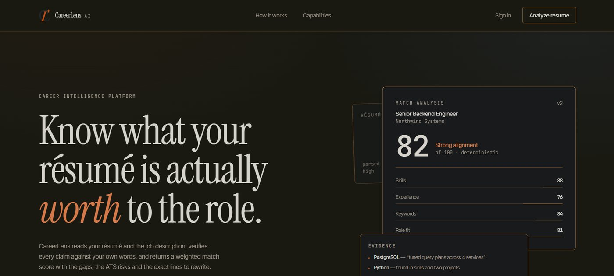
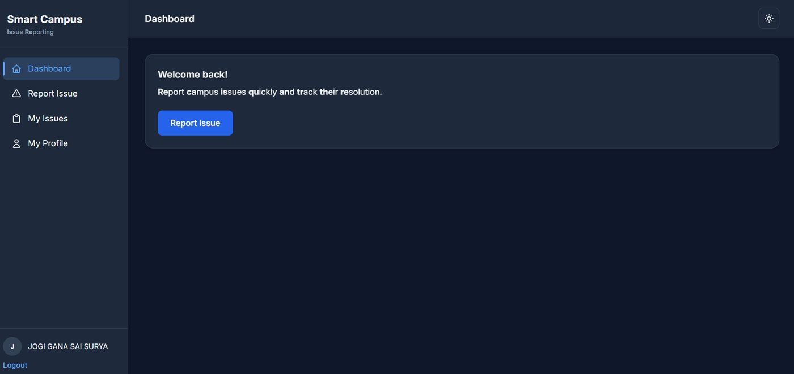

<div align="center">

<br />

<h3>I build LLM applications, RAG systems and automation, and ship them as working products.</h3>
<p>Computer Science student in Hyderabad &middot; Open to internships and full-time roles</p>
<p>
<a href="https://gana9989.github.io/Portfolio2/"></a>
<a href="assets/resume.pdf"></a>
<a href="https://www.linkedin.com/in/jogi-gana-sai-surya-b6bb36315/"></a>
<a href="mailto:jogigana18@gmail.com"></a>
</p>
<p>
<a href="https://leetcode.com/u/Gana_Sai/"></a>
<a href="https://www.kaggle.com/ganasaisurya"></a>
<a href="https://github.com/Gana9989"></a>
</p>
</div>
---
At a glance
🎓 Education	🏆 CGPA	📜 Certificates	🛠️ Projects
B.Tech CSE, Pallavi Engineering College	9.3	8 (Google, IBM, Udemy and more)	5 built, 2 live
About
I'm a B.Tech Computer Science and Engineering student specializing in Data Science, full-stack development and Generative AI. I started with Java and data structures, then moved into Python, LLMs and automation.
I like designing the whole system: the data layer, the API, the interface and the AI workflow around them. I'm looking for an AI/ML or software engineering role where I can keep building products people actually use.
Tech stack
<div align="center">

</div>
Area	Skills
Languages	Python, JavaScript, TypeScript, SQL, Java, C, C++
AI and data	Generative AI, LLMs, RAG, LangChain, ChromaDB, Prompt Engineering, Machine Learning, Pandas, NumPy
Web	React.js, Node.js, Express.js, Flask, Streamlit, MongoDB, REST APIs, HTML5, CSS3
Automation and tools	n8n, Git, GitHub, Web Scraping, VS Code
Computer science	Data Structures and Algorithms, OOP, DBMS, Operating Systems
Featured projects
CareerLens AI: Resume Analyzer and Job Matcher

Problem: candidates can't tell how well a résumé fits a role. Solution: a platform that matches a résumé to a job description and shows the evidence behind a weighted score. Impact: clear skill gaps and concrete lines to rewrite.
`React.js` `TypeScript` `Generative AI` `LLMs` · Live demo →
Smart Campus Issue Reporting System

Problem: campus issues get lost between students and staff. Solution: a full-stack app where students report issues and track status, with an admin dashboard for staff. Impact: one place to report, assign and resolve.
`Python` `Flask` `Web Scraping` `CSS3` · Live demo →
More projects
Project	What it does	Stack
RAG Document Q&A Chatbot	Ask questions over your own PDFs. Documents are chunked, embedded locally and stored in a vector database, then the most relevant passages are sent to Claude to answer.	LangChain, ChromaDB, Claude API, Streamlit
AI Email Assistant	An n8n workflow that classifies incoming Gmail with Claude, logs it to Google Sheets, sends Slack alerts, creates Calendar events and labels the email.	n8n, Claude, Gmail, Slack
Smart Vehicle Parking System	IoT-integrated system that monitors occupancy and allocates parking slots in real time, documented with architecture diagrams and flowcharts.	Node.js, React.js, MongoDB, IoT
Certificates
Certificate	Issuer	Date	Link
Google AI Professional Certificate (7 courses)	Google	Jul 2026	Verify
The Complete Full-Stack Web Development Bootcamp (62 hours)	Udemy	Nov 2026	Verify
Java + DSA Course	Code with Swaroop (MentiBy)	Nov 2026	View
Data Analysis with Python: From Raw Data to Insights	IBM, Coursera	Sep 2026	Verify
Databases and SQL for Data Science with Python	IBM, Coursera	Aug 2026	Verify
Python Project for Data Science	IBM, Coursera	Aug 2026	Verify
Python for Data Science and AI: Hands-On Development	IBM, Coursera	Aug 2026	Verify
Data Science Foundations: Tools, Careers and Real-World Applications	IBM, Coursera	Jul 2026	Verify
Education
Qualification	Institution	Period	Score
B.Tech, Computer Science and Engineering	Pallavi Engineering College, Hyderabad	Jul 2024 – Present	CGPA 9.3
Intermediate (Class XII)	SR Junior College, Hyderabad	Jun 2022 – May 2024	944/1000
Secondary School Certificate (Class X)	Deepti Public School, Andhra Pradesh	May 2022	
GitHub activity
<div align="center">


</div>
About this website
My portfolio is a static site built with plain HTML, CSS and JavaScript (no frameworks or build step). It has a light and dark theme, a responsive layout, scroll animations and a downloadable resume.
Live: https://gana9989.github.io/Portfolio2/
```text
Portfolio2/
├── index.html
├── style.css
├── script.js
├── README.md
└── assets/
    ├── photo.jpg
    ├── resume.pdf
    ├── projects/
    │   ├── careerlens.jpg
    │   └── smart-campus.jpg
    └── certificates/
        └── java-dsa-mentiby.jpg
```
To run it locally, clone the repository and open `index.html` in a browser. To deploy your own copy, push it to GitHub and enable Settings → Pages → Deploy from a branch → `main` / `(root)`.
Let's connect
I'm open to AI/ML, data science and software engineering internships and full-time roles, and to collaborating on AI projects and open source.
📧 jogigana18@gmail.com · 💼 LinkedIn · 🧩 LeetCode · 📊 Kaggle
<div align="center">

</div>
